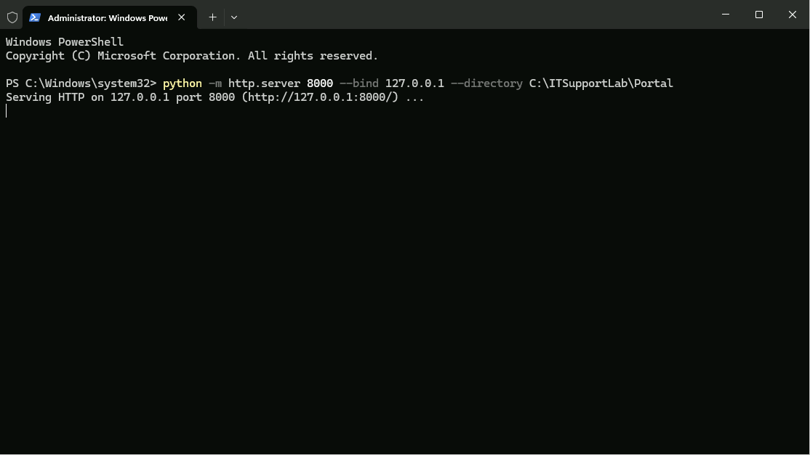
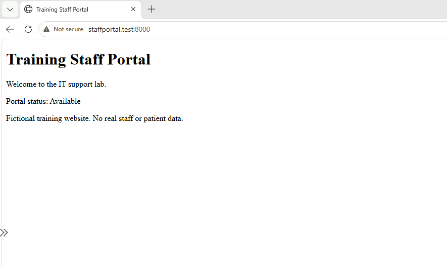
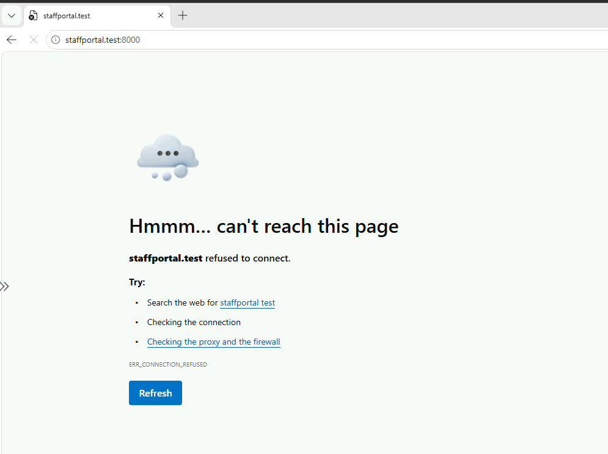
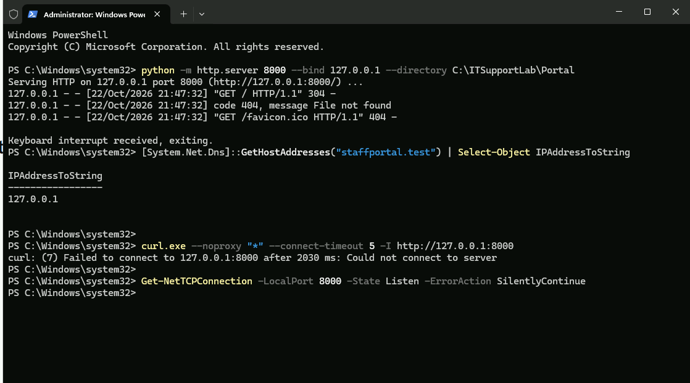
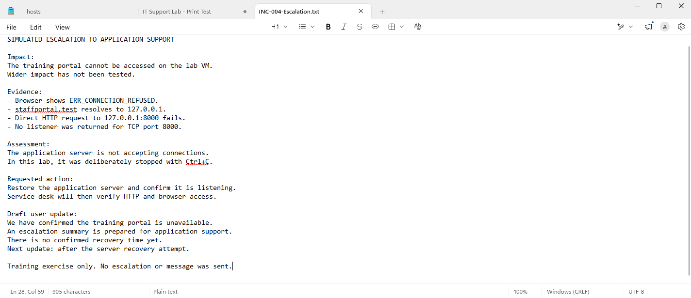
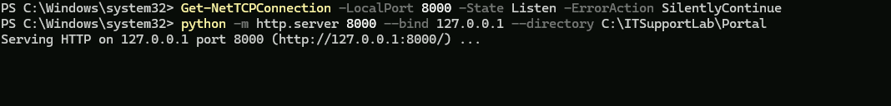
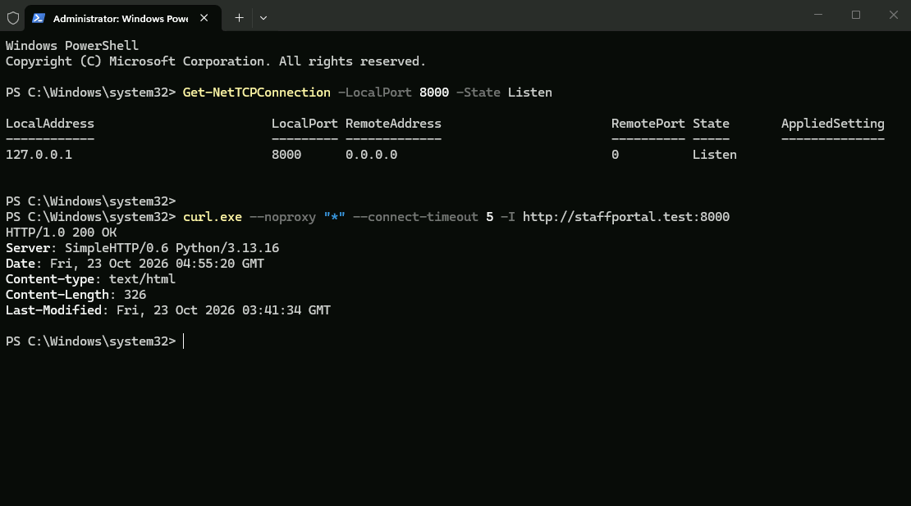
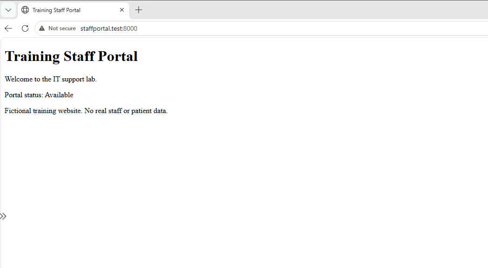
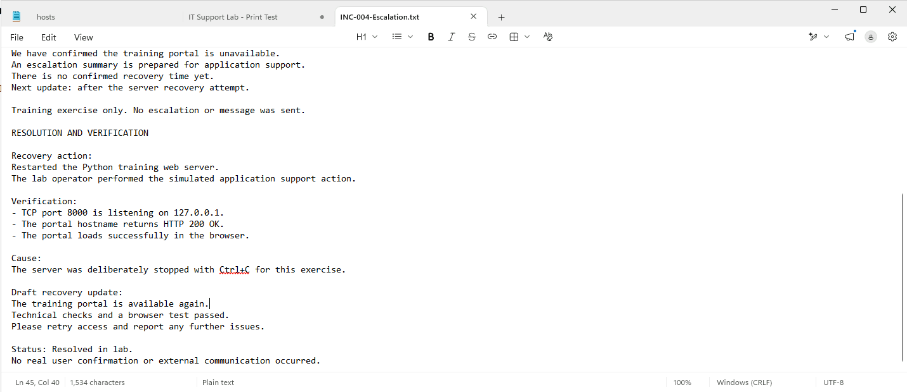

# Application Outage and Escalation

**Author:** Justice Zulueta  
**Environment:** One Windows 11 Pro Azure VM  
**Outcome:** Training portal restored; listener, HTTP response, and browser access verified.

## Project overview

This independent service desk lab demonstrates application outage triage, evidence gathering, a simulated escalation, draft user updates, recovery, and closure documentation. It reuses the local training portal from my Internal Portal Troubleshooting project.

The two projects investigate different failures: Project 2 corrected an incorrect hosts-file mapping; this project keeps the correct mapping and deliberately stops the application server. The additional focus is preparing a useful handover and verifying recovery before recording resolution.

This is a training simulation using fictional data. No real user, healthcare system, support team, or patient information was involved. I performed both the service desk checks and the simulated application support recovery. No escalation or user message was sent.

## Problem and impact

The training staff portal becomes unavailable after its Python server is deliberately stopped. Microsoft Edge displays `ERR_CONNECTION_REFUSED`.

The observed scope is one browser and local endpoint on one VM. In a workplace, loss of access to an internal application could delay staff tasks. Wider impact, affected user numbers, clinical urgency, and an approved workaround would need to be established before assigning a priority. This lab does not claim an organisation-wide outage or an SLA result.

## Environment and tools

| Component | Use |
|---|---|
| Windows 11 Pro in Azure | Single lab machine hosting the server and browser |
| Python 3.13.16 / http.server | Serve an existing static training page |
| Microsoft Edge | Observe failure and verify page recovery |
| Windows PowerShell | Start the server, check hostname resolution, and inspect the TCP listener |
| curl.exe | Test HTTP access without a proxy |
| Notepad | Prepare escalation, draft updates, and resolution notes |

The endpoint is `http://staffportal.test:8000`, mapped locally to `127.0.0.1`. The server serves `C:\ITSupportLab\Portal` and binds only to loopback. It is a foreground Python process, not a Windows service. No additional VM or public network exposure was needed.

## Workflow and evidence

### 1. Establish a working baseline

I opened Windows PowerShell and started the existing training portal:

```powershell
python -m http.server 8000 --bind 127.0.0.1 --directory C:\ITSupportLab\Portal
```

The console displayed `Serving HTTP on 127.0.0.1 port 8000`.



I opened `http://staffportal.test:8000` in Edge and confirmed the training page loaded. The “Available” label is static page text; the browser result demonstrates that the page could be retrieved or revalidated at baseline.



### 2. Introduce and reproduce the outage

I pressed **Ctrl + C** in the server console to stop the application, then refreshed the browser. Edge displayed `ERR_CONNECTION_REFUSED`.



### 3. Gather evidence before recovery

In PowerShell, I ran:

```powershell
[System.Net.Dns]::GetHostAddresses("staffportal.test") | Select-Object IPAddressToString
curl.exe --noproxy "*" --connect-timeout 5 -I http://127.0.0.1:8000
Get-NetTCPConnection -LocalPort 8000 -State Listen -ErrorAction SilentlyContinue
```

| Check | Observed result | Interpretation |
|---|---|---|
| System hostname resolution | 127.0.0.1 | The hostname resolves to the intended loopback address |
| Direct HTTP request | curl error 7: could not connect | The failure also occurs when bypassing the hostname |
| TCP listener query | No output | Consistent with the server having stopped |
| Server console | Keyboard interrupt received, exiting | Records the deliberate application stop |



The listener query suppressed errors, so its empty output alone is not conclusive proof. The known controlled stop, console message, and failed direct connection provide supporting evidence. The .NET method uses Windows hostname resolution; it is not evidence of an external DNS server query or DNS server outage.

The console also shows an earlier request for `/favicon.ico` returning 404. That missing browser icon is separate from the later connection refusal after the server stopped.

### 4. Prepare a simulated escalation and user update

I saved `INC-004-Escalation.txt` in Documents. It records the observed impact, exact symptoms, checks, assessment, requested recovery action, a draft user update, and the limit of the tested scope.



The handover asks simulated application support to restore the server, with service desk verification to follow. In a real environment, application recovery would follow the relevant runbook and permissions. This exercise uses a prepared handover, rather than claiming another team received or actioned it.

### 5. Restore the application

Acting as the lab operator, I started the Python server again using the same command. The console returned to `Serving HTTP`.



I kept that window open and used a second PowerShell window for verification.

### 6. Verify recovery at three levels

```powershell
Get-NetTCPConnection -LocalPort 8000 -State Listen
curl.exe --noproxy "*" --connect-timeout 5 -I http://staffportal.test:8000
```

The TCP query showed a listener on `127.0.0.1:8000`. The HTTP request through the portal hostname returned `HTTP/1.0 200 OK`.



I then refreshed the portal in Edge and confirmed the expected page rendered again.



### 7. Record resolution and draft the recovery update

I appended the recovery action, three verification results, controlled cause, draft recovery update, and lab closure status to the incident notes.



## Result and lessons learned

The stopped foreground server caused the controlled outage. Starting it again restored local access. No hosts-file, firewall, or account changes were needed. Verification covered the TCP listener, an HTTP response through the hostname, and the rendered browser page.

- Compare hostname access with direct IP access to narrow the problem.
- Separate evidence from assumptions about wider impact or root cause.
- Give the receiving team actionable notes and a clear recovery request.
- Draft user updates in plain language without inventing a recovery time.
- Verify the user-facing result before documenting resolution.

This exercise did not test real multi-user access, remote clients, authentication, databases, clinical transactions, high availability, or long-term stability. Restoring a static page does not demonstrate recovery of a full production application. No actual ticketing platform, team handover, independent user confirmation, or resolution duration is claimed.

## Supporting documentation

- [Simulated incident record INC-004](docs/INC-004.md)
- [Escalation and resolution notes](docs/INC-004-Escalation.txt)
- [Application outage support guide](docs/application-outage-guide.md)
